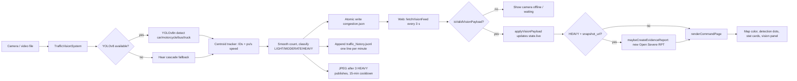
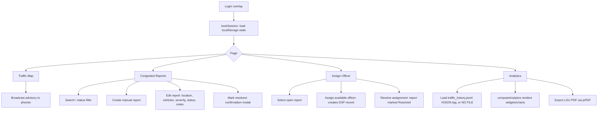

# BITCAS — System Overview & Context Document

**Barangay Intelligent Traffic Congestion Alert System (BITCAS)**
Target site: Villamonte Street Intersection, Barangay Villamonte, Bacolod City
Last updated: 2026-09-18 (vision node v2 + predictive analytics)

> **Vision node v2 is in.** The Pi now counts each vehicle once as it crosses a
> virtual line, measures road occupancy, reports km/h after calibration, and
> emits a continuous 0–100 congestion score with a fourth CRITICAL band.
> History is append-only JSONL instead of a 650 KB file rewritten every 3 s.
>
> **Predictive analytics are in.** An hourly rollup (`traffic_hourly.jsonl`)
> feeds an hour × weekday heatmap, an incident detector that compares the last
> 10 minutes against the same slot in prior weeks, and a 15/30/60-minute
> congestion forecast. All three state plainly when they lack the history to
> answer rather than guessing.
>
> See [BITCAS_MASTER_PLAN.md](BITCAS_MASTER_PLAN.md) for the reasoning and the
> remaining phases. Sections below marked **(v2)** describe the new behaviour.

---

## 1. System Overview

BITCAS is an LGU traffic-monitoring and dispatch system with two runtime components that communicate through **shared JSON files** (no database, no API layer):

1. **Vision node** (`vision/traffic_vision.py`) — Python + YOLOv8n processes a camera/video feed, detects and tracks vehicles, classifies congestion, and atomically writes results to JSON files that the web app reads.
2. **Web dashboard** (PHP + vanilla JS MVC on XAMPP) — an operator dashboard for the traffic desk: live map, congestion reports, officer dispatch, analytics, and PDF reporting.

The loose coupling is deliberate: either side can fail without crashing the other, and the vision node can be deployed on a Raspberry Pi on the same network, writing into the web server's shared data folder.

---

## 2. Architecture

```
┌──────────────────────────┐         shared filesystem          ┌──────────────────────────────┐
│      VISION NODE         │  ── congestion.json (live) ──────▶ │        WEB DASHBOARD         │
│  traffic_vision.py       │  ── traffic_history.jsonl ──────▶  │  Apache/PHP (XAMPP)          │
│  YOLOv8n / OpenCV        │  ── traffic_hourly.jsonl ───────▶  │  index.php + app/views/      │
│  (Raspberry Pi target)   │  ── crossings.jsonl ────────────▶  │  Client MVC: assets/js/mvc/  │
│                          │  ── assets/snapshots/ ──────────▶  │  State: browser localStorage │
└──────────────────────────┘                                    └──────────────────────────────┘

  minute aggregates → ~2 days in the browser → KPIs, hourly profile, anomalies
  hourly rollups    → weeks in the browser   → heatmap, baselines, forecast
```

### 2.1 Vision node (`vision/`) **(v2)**

| Item | Detail |
|---|---|
| Main class | `TrafficVisionSystem` in [traffic_vision.py](../vision/traffic_vision.py) |
| Site config | [site_config.json](../vision/site_config.json) — ROI polygon, counting lines, homography, capacity, free-flow speed, score weights and bands. All image coordinates normalised 0–1 so they survive a resolution change |
| Calibration | [calibrate.py](../vision/calibrate.py) — click the ROI, counting line and 4-point speed rectangle on a real frame, then save back to the config |
| Detector | Ultralytics YOLOv8n via NCNN (preferred on Pi) or PyTorch; COCO classes 2/3/5/7 → car/motorcycle/bus/truck; Haar-cascade fallback |
| Capture | `FrameGrabber` background thread keeps only the newest frame, so analysis never lags behind the camera buffer |
| Tracking | `CentroidTracker` with tracks keyed by track ID; greedy shortest-pair association; least-squares velocity over the track's position history |
| Counting | `CountingLine` — sign change across the line plus a segment-intersection test; deduped per track, so each vehicle counts exactly once, with direction |
| Density | Road-ROI occupancy: vehicle box area ∩ ROI ÷ ROI area |
| Scoring | Continuous 0–100 from `0.45×occupancy + 0.30×load + 0.25×slowness`; bands LIGHT / MODERATE / HEAVY / CRITICAL. With no speed calibration, the slowness weight is redistributed rather than guessed |
| Smoothing | Time-based window (`smoothing_window_seconds`, default 30 s) — v1's `deque(maxlen=30)` was 30 *frames*, about one second |
| Writes | `congestion.json` (live payload, atomic) · `traffic_history.jsonl` (append-only, one aggregate per minute) · `traffic_hourly.jsonl` (append-only, one rollup per hour) · `crossings.jsonl` (append-only, one line per counted vehicle) |
| Rollup | `aggregate_minute_records()` folds each hour's minute records into one line on the hour boundary, and on shutdown so a partial hour is not lost. This is the job a database cron would do in Phase 2 |
| Safety | `_atomic_write_json()` writes `.tmp` then `os.replace()`; buffered crossings and history are flushed on Ctrl+C |
| Snapshots | `assets/snapshots/`, fires on HEAVY **or** CRITICAL, 15-minute cooldown, max 100 |
| Tuning | `--backend {auto,ncnn,pytorch,haar}`, `--inference-size`, `--detect-every`, `--threads`, `--confidence`, `--update-interval`, `--config`, `--no-display` |
| Self-test | [selftest.py](../vision/selftest.py) — runs the whole pipeline on synthetic detections; no camera or YOLO needed |

Payload contract v2 (consumed by the web app; v1 keys are retained for
compatibility so a dashboard update is never required in lockstep):

```json
{
  "schema": 2,
  "camera_id": "CAM-VILLAMONTE-01",
  "timestamp": "ISO-8601",
  "congestion_level": "LIGHT | MODERATE | HEAVY | CRITICAL",
  "congestion_score": 58,
  "vehicles_in_frame": 11,
  "occupancy_pct": 34.2,
  "avg_speed_kph": 21.7,
  "speed_calibrated": true,
  "flow": { "window_seconds": 3, "per_minute": 23.0, "inbound": 4, "outbound": 6 },
  "totals": { "date": "2026-09-18", "today": 8644, "by_class": {}, "by_direction": {} },
  "crossings": [ { "track_id": 418, "vehicle_class": "motorcycle", "direction": "inbound", "speed_kph": 23.4 } ],
  "health": { "fps": 6.2, "backend": "ncnn", "cpu_temp_c": 58.4, "uptime_s": 84213,
              "roi_calibrated": true, "lines_calibrated": true },
  "snapshot_url": "assets/snapshots/… (optional, triggers evidence report)",

  "color": "#f39c12", "label": "MODERATE", "vehicle_count": 11,
  "source": "traffic_vision_system", "vehicle_types": { "car": 7 },
  "positions": [0.0–1.0 fractions along the road], "avg_speed": 21.7
}
```

**`vehicles_in_frame` is occupancy, `totals.today` is throughput.** They answer
different questions and must never be substituted for one another — this was
the single biggest correctness problem in v1.

### 2.2 Web server (PHP)

- [index.php](../index.php) — front controller. Hands the request to `PageController`.
- [app/controllers/PageController.php](../app/controllers/PageController.php) — whitelists `?page=` (`command`, `analytics`, `incidents`, `dispatch`, `accounts`) and renders [app/views/layout.php](../app/views/layout.php).
- [app/controllers/AdvisoryController.php](../app/controllers/AdvisoryController.php) — broadcast and clear. The public URL stays [api/advisories.php](../api/advisories.php).
- [app/models/AdvisoryStore.php](../app/models/AdvisoryStore.php) — reads and writes `assets/data/advisories.json`, then calls OneSignal.
- [app/views/partials/sidebar.php](../app/views/partials/sidebar.php) — navigation with live open-report badge (`reportNavCount`).
- [app/views/pages/command.php](../app/views/pages/command.php) — Traffic Map page: stat cards, map panel, vision feed panel, advisory broadcast form, advisory timeline.
- [app/views/pages/incidents.php](../app/views/pages/incidents.php) — Congested Reports page: searchable/filterable list + editor + resolve confirmation modal.
- [app/views/pages/dispatch.php](../app/views/pages/dispatch.php) — Assign Officer page: open-report queue, officer pool, assignment tracking.
- [app/views/pages/analytics.php](../app/views/pages/analytics.php) — Analytics page: KPI widgets, 7-day trend, hourly chart, hotspot ranking, class distribution, PDF export.
- [app/views/partials/map.php](../app/views/partials/map.php) — shared Leaflet container + legend.

### 2.3 Client MVC (`assets/js/mvc/`)

| Layer | File | Responsibility |
|---|---|---|
| Core | [constants.js](../assets/js/mvc/core/constants.js) | Storage keys, JSON URLs, poll interval (3 s), Villamonte road GeoJSON, history start cutoff |
| Core | [helpers.js](../assets/js/mvc/core/helpers.js) | Formatting, severity/classification mapping, `isValidVisionPayload()`, DOM helpers |
| Model | [store.js](../assets/js/mvc/models/store.js) | Single `state` object in localStorage (`bitcas_ui_ops_v1`); auth session; `fetchVisionFeed()` / `fetchVisionHistory()`; `applyVisionPayload()`; `maybeCreateEvidenceReport()`; advisories |
| Model | [analyticsModel.js](../assets/js/mvc/models/analyticsModel.js) | `computeAnalytics()` — rolling/baseline averages, congestion duration, week trend, resolution time, 7-day trend, peak hour, hotspots, class counts |
| Views | `authView.js`, `commandView.js`, `analyticsView.js`, `reportsView.js`, `dispatchView.js` | Pure DOM rendering; Leaflet map layers; jsPDF export |
| Controllers | `authController.js`, `commandController.js`, `analyticsController.js`, `reportsController.js`, `dispatchController.js` | Event binding, interaction state, vision polling loop |
| Bootstrap | [app.js](../assets/js/mvc/app.js) | `DOMContentLoaded` → sidebar → `initAuth()` → `bootSession()` → page controller by `body[data-page]` |

**State model**: reports, officers, assignments, and the live reading live in one localStorage object. A first super admin is created when storage is empty. Advisories are the shared `advisories.json` file. No MySQL yet.

---

## 3. Process Flow

### 3.1 Vision → Dashboard (live feed)



### 3.2 Operator workflows



### 3.3 Data lifecycle

- **Live**: `congestion.json` polled every `VISION_POLL_MS = 3000`; new telemetry entries appended (capped at 240 in state); dashboard re-renders. A payload older than `VISION_STALE_MS` (30 s) raises the **camera offline** banner.
- **History**: `traffic_history.jsonl` only. Lines before `2026-10-07T15:33:00`, and any line whose in-frame count reaches 30, are skipped. Those minutes are the broken PyTorch run. Capped at `VISION_HISTORY_MAX_ENTRIES` (2,880 ≈ 2 days). The source tag reads **VISION**, **SAMPLE DATA**, or **NO FILE**.
- **Hourly rollups**: `traffic_hourly.jsonl` is fetched alongside the minute history and capped at `VISION_HOURLY_MAX_ENTRIES` (1,440 ≈ 2 months). It is derived, read-only data, so it is held in memory instead of localStorage. The heatmap, the anomaly baselines and the forecast all read this; none of them touch the minute file for history.
- **Reports**: start empty. A case is opened when the live payload is HEAVY and carries `snapshot_url` (deduplicated by that URL, capped at 120), or when an operator creates one.
- **Persistence**: desk mutations call `saveState()` → localStorage. Clearing browser storage keeps the login account and drops local reports. The Pi files are unchanged.

---

## 4. Real vs Mock Matrix

### ✅ Real (implemented and functional)

| Capability | Where |
|---|---|
| YOLOv8 vehicle detection, centroid tracking, speed estimation, congestion classification | [traffic_vision.py](../vision/traffic_vision.py) |
| **(v2)** Per-vehicle counting with direction, road occupancy, continuous score, CRITICAL band, km/h after calibration, node health | `CountingLine`, `CongestionModel`, `Calibration` in [traffic_vision.py](../vision/traffic_vision.py) |
| **(v2)** Interactive ROI / counting-line / homography calibration | [calibrate.py](../vision/calibrate.py) |
| **(v2)** Append-only JSONL telemetry (~0.4 MB/day vs ~18.7 GB/day in v1) | `TelemetryWriter` |
| **(v2)** Honest analytics: metrics the data cannot support render as a dashed card with the reason | `computeDataCapability` in [analyticsModel.js](../assets/js/mvc/models/analyticsModel.js) |
| **(v2)** Hour × weekday heatmap over hourly rollups, congestion or volume, with per-cell sample counts and hatched never-observed cells | `computeHeatmap` / `renderHeatmap` |
| **(v2)** Incident detection: stall signature (speed collapse with occupancy held), flow collapse, flow stoppage, and z-score outliers against the same weekday and hour in prior weeks | `detectAnomalies` |
| **(v2)** 15/30/60-minute congestion forecast blending the slot's historical mean with the current 30-minute trend, with stated confidence and basis | `computeForecast` |
| Atomic JSON output | `_atomic_write_json` |
| Live polling of vision feed every 3 s with payload validation | `fetchVisionFeed`, `isValidVisionPayload` in [store.js](../assets/js/mvc/models/store.js) / [helpers.js](../assets/js/mvc/core/helpers.js) |
| Auto-creation of Severe evidence reports on sustained HEAVY + snapshot | `maybeCreateEvidenceReport` in [store.js](../assets/js/mvc/models/store.js) |
| Leaflet map: OSM tiles, Villamonte road polyline, detection markers, camera node, open-report markers, layer toggles | [commandView.js](../assets/js/mvc/views/commandView.js), [constants.js](../assets/js/mvc/core/constants.js) |
| Reports CRUD, search/filter, resolve confirmation modal | [reportsController.js](../assets/js/mvc/controllers/reportsController.js), [reportsView.js](../assets/js/mvc/views/reportsView.js) |
| Officer assignment + resolution tracking | [dispatchController.js](../assets/js/mvc/controllers/dispatchController.js), [dispatchView.js](../assets/js/mvc/views/dispatchView.js) |
| Analytics: rolling vs baseline average, congestion duration, week-over-week trend, resolution time, 7-day trend, peak hour, hotspots, class distribution | [analyticsModel.js](../assets/js/mvc/models/analyticsModel.js) |
| LGU PDF export — page 1 summary/hotspots/classifications, page 2 detected anomalies + forecast + historical basis | `exportAnalyticsPdf`, `appendForecastPage` in [analyticsView.js](../assets/js/mvc/views/analyticsView.js) |
| Advisory broadcast → `advisories.json` and OneSignal | `publishAdvisory` in [store.js](../assets/js/mvc/models/store.js), [AdvisoryController.php](../app/controllers/AdvisoryController.php) |

### 🟡 Still unfinished (not mock traffic)

| Item | Status |
|---|---|
| Authentication | Client-side accounts in localStorage until MySQL. A super admin is created on first run |
| Speed values | Real km/h **only after** `calibrate.py` has been run at the site. Until then the payload sets `speed_calibrated: false` and the dashboard says speed is off |
| Counting line and ROI | The yellow line and the full-frame area are still the uncalibrated placeholders in `site_config.json` |
| Intersection comparison | One camera, so a location ranking is this site only |
| Forecast and anomaly baselines | They need about two weeks of live capture before they describe Villamonte. History before 15:33 on 7 Oct 2026 is excluded |
| Desk persistence | Reports, officers, and assignments are browser localStorage. The live reading and the history files are on disk |

---

## 5. Testing & QA Plan

### 5.1 Vision node tests

| # | Test | Expected |
|---|---|---|
| V1 | Run with a sample MP4: `python traffic_vision.py --source <video.mp4>` | `congestion.json` is created in `assets/data/` and updates; overlay shows boxes + track IDs |
| V2 | Headless run (`--no-display`) | Runs without a window; JSON still written |
| V3 | Webcam source `--source 0` | Opens device or raises a clear `Cannot open video source` error |
| V4 | Schema check on `congestion.json` | All contract fields present; `congestion_level` ∈ {LIGHT, MODERATE, HEAVY}; numbers finite |
| V5 | Threshold boundaries: feed scenes with 4 / 5 / 14 / 15 vehicles | LIGHT→MODERATE at 5, MODERATE→HEAVY at 15 (after smoothing window) |
| V6 | Atomic write: poll file from another process during heavy write load | No partial/corrupt JSON reads |
| V7 | History file | `traffic_history.jsonl` gains one line per minute; the desk ignores lines before 15:33 on 7 Oct 2026 |
| V8 | YOLO unavailable (uninstall ultralytics) | Warning printed, Haar fallback still produces payloads |
| V9 | HEAVY + snapshot: sustain heavy traffic | Snapshot lands in `assets/snapshots/`; cooldown prevents spam (15 min) |

### 5.2 Frontend manual QA checklist

**Auth**
- [ ] Wrong credentials show error; correct ones (`lguadmin/bitcas123`) open the shell
- [ ] Refresh keeps the session; Logout returns to overlay
- [ ] User chip shows username initials/role

**Traffic Map (`?page=command`)**
- [ ] Stat cards update when the vision poller ticks (vehicle count, score, class, last sync)
- [ ] Vision source label shows "Live camera" when `congestion.json` is fresh, and "Waiting" when it is missing
- [ ] A stale reading shows the camera-offline banner
- [ ] Layer chips toggle road / detections / camera layers
- [ ] Detection dots move along the road per `positions` fractions
- [ ] HEAVY + `snapshot_url` auto-creates a new report (check nav badge increments)
- [ ] Advisory form adds to the timeline and can reach driver phones; Clear empties it

**Congested Reports (`?page=incidents`)**
- [ ] Search and status filter combine correctly
- [ ] "Create report" adds a new card and selects it in the editor
- [ ] Saving the editor updates the card (location, vehicles, severity, status, notes)
- [ ] "Mark resolved" opens the modal; Cancel does nothing; Confirm resolves and removes from the open queue
- [ ] Evidence panel shows the attached snapshot when present

**Assign Officer (`?page=dispatch`)**
- [ ] Open queue sorted by congestion score; Select highlights the report
- [ ] Assign is disabled for non-Available officers or when no report is selected
- [ ] Assigning creates a DSP row and flips officer status
- [ ] Resolve (per-row or "Resolve selected") marks the assignment Resolved and the report Resolved
- [ ] Shift clock ticks every second

**Analytics (`?page=analytics`)**
- [ ] Source tag shows VISION when `traffic_history.jsonl` loads, NO FILE when it doesn't
- [ ] Widgets render: rolling avg, baseline, delta, duration, week trend, resolution time
- [ ] 7-day chart and hourly chart render bars; empty history shows "No data"
- [ ] Hotspot ranking and class distribution match report data
- [ ] "Export LGU PDF" downloads `BITCAS_LGU_Report_<date>.pdf` with summary, hotspots, classifications

### 5.3 Data QA

| # | Test | Expected |
|---|---|---|
| D1 | Clear localStorage, reload | Desk boots with the super admin and empty reports |
| D2 | Corrupt `congestion.json` (invalid level / non-numeric count) | `isValidVisionPayload` rejects it; UI shows waiting, no crash |
| D3 | Missing `traffic_history.jsonl` | Analytics tag = NO FILE |
| D4 | Duplicate `snapshot_url` payloads | No duplicate evidence reports |
| D5 | Telemetry growth | Live buffer capped at 240; reports capped at 120 |

### 5.4 Cross-cutting

- [ ] Responsive: sidebar collapses and the ☰ toggle works on narrow screens
- [ ] Chrome / Edge / Firefox render identically (Leaflet + CSS grid)
- [ ] No console errors on any routed page
- [ ] App fully functional with no PHP backend logic beyond includes (open over `http://localhost/BITCAS_UI_Skeleton/`)

---

## 6. Known Limitations & Future Work

**Current limitations**
- Reports, officers, and assignments are browser localStorage; two desks do not share those
- Authentication is client-side until MySQL
- Speed is km/h **only after** running `calibrate.py`; until then the UI leaves speed off
- The ROI, counting line, and speed rectangle are not calibrated yet
- `capacity_vehicles` and `free_flow_kph` in `site_config.json` stay as starting values until a week of real data
- Centroid tracker can swap IDs under occlusion (counting-line dedup limits the damage)
- Single camera / single intersection (Villamonte) only
- History before 15:33 on 7 Oct 2026 is excluded from Analytics because the PyTorch detector on the Pi was numerically wrong

**Planned**
1. Real auth + user roles backed by MySQL
2. Calibrate the ROI, counting line, and speed rectangle on the Pi
3. Kalman filter or DeepSORT tracking for ID retention
4. HTTP API / WebSocket push to replace 3-second file polling
5. Scheduled summary reports
6. Multi-camera fusion
