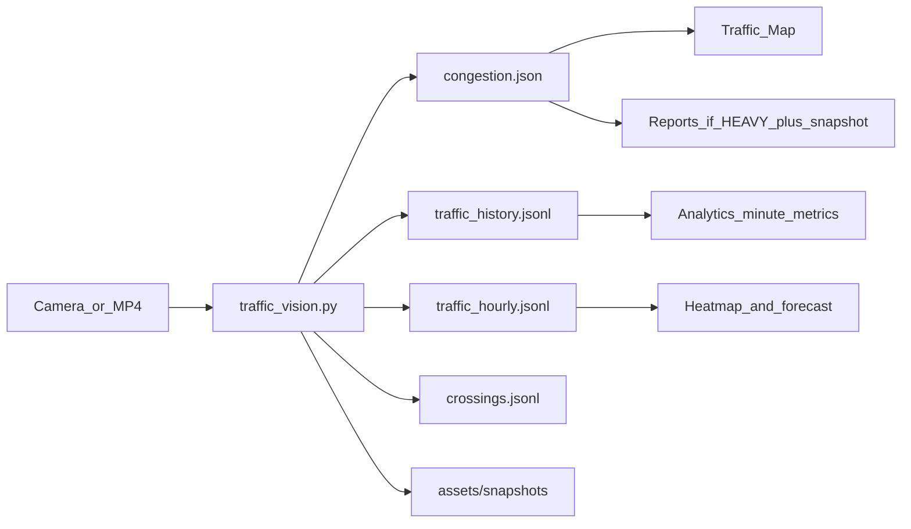

# BITCAS Vision Python — how the monitoring node works

This note is for reading the **v2** Python node, not the old v1 write-up under `vision/INFORMATION/`. Those files still mention vehicle-count thresholds and `index.html`. The live code is [`vision/traffic_vision.py`](../vision/traffic_vision.py).

Vision is a **monitoring node**. It is not the LGU dashboard. It watches a camera or an MP4, measures traffic, and **writes files**. The PHP/JS UI never calls Python. It polls those files every 3 seconds.



---

## 1. Purpose

| What vision does | What it does not do |
|---|---|
| Detect and track vehicles in the frame | Host the dashboard, login, or officer roster |
| Count each vehicle **once** when it crosses a line | Talk to OneSignal or assign officers |
| Score congestion 0–100 and label LIGHT / MODERATE / HEAVY | Store reports in a database |
| Publish live JSON + append history | Compute LGU KPIs — that is `analyticsModel.js` |

Laptop demo and Pi field run use the **same script**. Only the source and the `--pi` flags change.

---

## 2. Python files — what each one is for

| File | Purpose |
|---|---|
| [`vision/traffic_vision.py`](../vision/traffic_vision.py) | Live loop: grab → detect → track → count → score → write files |
| [`vision/calibrate.py`](../vision/calibrate.py) | Click ROI, counting line, and 4-point speed rectangle on a still frame; saves into `site_config.json` |
| [`vision/site_config.json`](../vision/site_config.json) | Site name, camera id, bands, capacity, publish intervals, calibration flags |
| [`vision/selftest.py`](../vision/selftest.py) | Feeds synthetic detections through the real classes and checks the JSON contract |
| [`vision/make_sample_data.py`](../vision/make_sample_data.py) | Writes fake JSONL so Analytics can render without a camera. **Do not run this on the Pi in production** |

Supporting pieces next to the script (not all committed): `yolov8n.pt` (PyTorch weights), `yolov8n_ncnn_model/` (Pi-friendly export).

---

## 3. Classes in `traffic_vision.py`

No line-by-line dump. Each class has one job.

| Class | Purpose |
|---|---|
| `CountingLine` | Virtual line on the road. A track that crosses it produces **one** inbound or outbound event. |
| `Calibration` | 4-point homography: pixel → metres on the ground. If `calibrated` is false, speed stays in px/s and `avg_speed_kph` is `null`. |
| `FrameGrabber` | Camera: background thread, keep only the newest frame. File: read every frame in order and pace to the file FPS (so the demo is not fast-forward). |
| `VehicleDetector` | YOLOv8n (NCNN or PyTorch) or Haar cascade fallback. Keeps only COCO classes **2 / 3 / 5 / 7** — car, motorcycle, bus, truck. |
| `Track` | One vehicle across frames: id, bbox, centroid history, which lines it already crossed, speed. |
| `CentroidTracker` | Matches this frame’s detections to last frame’s tracks by nearest centroid. That ID is what makes “count once” and speed possible. |
| `CongestionModel` | Time-smoothed in-frame count + occupancy + optional slowness → score 0–100 and a level name. |
| `TelemetryWriter` | Atomic overwrite of `congestion.json`; append-only JSONL for history, hourly, and crossings. |
| `TrafficVisionSystem` | Wires the pieces and runs the loop (`run()`). |

Helpers around them: `load_site_config()` merges `site_config.json` onto built-in defaults; `aggregate_minute_records()` rolls a stack of minute lines into one hourly line.

---

## 4. Process — one cycle of `run()`

Defaults come from `site_config.json` → `publish.update_interval_seconds` = **3 s**, `history_interval_seconds` = **60 s**, `snapshot_streak` = **3**, `snapshot_cooldown_seconds` = **900**.

1. **Grab frame** — `FrameGrabber.read()`. Live camera drops stale frames. A video file does not.
2. **Detect** (every Nth frame) — `VehicleDetector.detect()`. `--detect-every 2` on the Pi skips YOLO on alternate frames; tracking still updates IDs.
3. **Track** — `CentroidTracker.update()`. New box near an old centroid keeps the same `track.id`. Tracks older than `tracking.max_age_seconds` (2 s) die.
4. **ROI filter** — centroids outside the polygon are ignored for occupancy, score, and “in frame.” Uncalibrated ROI = **the whole frame**.
5. **Count once** — `_register_crossings()`. If the centroid path crosses a `CountingLine` and that line id is not already in `track.counted_lines`, emit one crossing (class + direction + optional km/h).
6. **Occupancy** — `_occupancy_fraction()`: union of vehicle boxes ∩ ROI, divided by ROI area. This is **density**, not “cars today.”
7. **Speed** — least-squares fit over the track history. With calibration: km/h (implausible values above `max_plausible_kph` are dropped). Without: px/s only; payload `avg_speed_kph` is `null`.
8. **Score** — `CongestionModel.score()` then `level()`.
9. **Publish every 3 s** — `_build_payload()` → `TelemetryWriter.write_current()` overwrites `assets/data/congestion.json` atomically (write temp, then replace).
10. **History every 60 s** — average the 3 s samples in the bucket → **one line** appended to `traffic_history.jsonl`.
11. **Hourly rollup** — when the clock hour changes, those minute lines become one line in `traffic_hourly.jsonl`.
12. **Snapshot** — only if the last **3** publishes were HEAVY **and** the cooldown has passed. JPEG goes to `assets/snapshots/heavy_YYYYMMDD_HHMMSS.jpg` and `snapshot_url` is set on that live payload. The dashboard then may create a Reports case.

On Ctrl+C, `_final_flush()` writes leftover crossings and history so a stop does not drop counts.

### Congestion score (what the number means)

Weights in `site_config.json` (must stay in step with the UI `CONGESTION_BANDS` / `VISION_LEVELS`):

- occupancy **0.45** — share of the ROI covered by boxes, scaled while the ROI is still the whole frame  
- load **0.30** — smoothed in-frame count / `capacity_vehicles` (default **12**)  
- slowness **0.25** — stopped vs moving. Uses km/h after speed calibration; otherwise pixel speed (`stopped_pps` / `free_flow_pps`) so a paused queue still scores  

**Score (always three terms):**

`score = 100 × (0.45 × occupancy_term + 0.30 × load + 0.25 × slowness)`

Uncalibrated occupancy is `raw_occupancy / busy_occupancy` (default 0.16). That means ~16% of the whole frame covered counts as a full road for this camera. After `calibrate.py` draws the road, occupancy is used raw.

Slowness is 1 when vehicles are present and centroids barely move (`≤ stopped_pps`, default 8 px/s). One or two stopped cars are scaled down; three or more is a queue.

Bands stay **LIGHT** 0–39, **MODERATE** 40–64, **HEAVY** 65–100. Smoothing is **12 s**.

If a test MP4 still sits in LIGHT, the view is almost empty — not because the bands are unreachable. Restart `traffic_vision.py` after changing `site_config.json`.

---

## 5. Files vision writes

All default paths sit next to the web app so XAMPP can serve them:

| Path | How it is written | Who reads it |
|---|---|---|
| `assets/data/congestion.json` | Overwritten every 3 s | Traffic Map (poll), Reports (HEAVY + `snapshot_url`) |
| `assets/data/traffic_history.jsonl` | One aggregated line per minute | Analytics (minute metrics; browser keeps ~2880 lines ≈ 2 days) |
| `assets/data/traffic_hourly.jsonl` | One line per clock hour | Analytics heatmap + forecast (up to 1440 hours in memory) |
| `assets/data/crossings.jsonl` | One raw crossing per counted vehicle | **Dashboard does not read this today.** Kept as a spool / audit log |
| `assets/snapshots/*.jpg` | Evidence JPEG, max 100, then oldest deleted | Reports / Dispatch when `snapshot_url` is present |

v1 used a growing `traffic_history.json` array rewritten every 3 s. v2 appends JSONL so the Pi SD card is not rewritten in full every cycle.

---

## 6. Live payload (`congestion.json`) — what Map and Reports use

Built in `_build_payload()`. Schema **2**. `source` is `traffic_vision_system`.

| Field | Meaning | Used on |
|---|---|---|
| `congestion_level` | LIGHT / MODERATE / HEAVY | Map color, captions, report severity |
| `congestion_score` | Integer 0–100 | Map KPI, report score |
| `vehicles_in_frame` | Boxes in the ROI **right now** (occupancy sample) | “Vehicles in frame” |
| `smoothed_vehicle_count` | Same measure, 30 s average | Scoring load term |
| `occupancy_pct` | ROI coverage × 100 | Vision feed, Analytics occupancy |
| `avg_speed_kph` | Mean track speed, or `null` | Speed KPI only if `speed_calibrated` |
| `speed_calibrated` | Homography on or off | Capability flag |
| `flow.per_minute` | Crossings in this 3 s window × 60 / window | Live flow line |
| `flow.inbound` / `outbound` | Direction counts in that window | Live summary |
| `totals.today` | Vehicles that crossed the line since midnight | “Counted today” |
| `totals.by_class` / `by_direction` | Day totals | Mix / direction on the live card |
| `crossings` | Last up to 20 crossing objects in this window | Map does not list them; count feeds telemetry |
| `vehicle_types` | In-frame class counts this sample | Map types line |
| `positions` | `{x, y, class}` per ROI track. `x`/`y` are centroid ÷ frame size (0–1). | Map dots on ~120 m of road around the camera (schematic, not GPS) |
| `health.fps`, `backend`, `cpu_temp_c`, `uptime_s` | Node health | Vision feed “Node” line |
| `snapshot_url` | Set only on an evidence publish | Reports case file |
| `lat`, `lng` | Camera site from `site_config.json` | Map camera pin |
| `camera_id`, `site_name`, `timestamp` | Identity | Labels, stale check (30 s) |

v1 aliases (`vehicle_count`, `color`, `label`) stay on the payload so an older UI would still parse it.

**Reports rule (browser, not Python):** `maybeCreateEvidenceReport()` creates a case only if the payload is HEAVY **and** has `snapshot_url`, and it is not a `bitcas_simulation` sample. Older files that still say CRITICAL are treated as HEAVY.

---

## 7. Analytics — what data vision actually passes

Analytics does **not** re-run YOLO. [`analyticsModel.js`](../assets/js/mvc/models/analyticsModel.js) only derives numbers from:

1. Live telemetry folded from `congestion.json` (short, in `localStorage` as `liveTelemetry`)
2. Minute lines from `traffic_history.jsonl` (loaded on the Analytics page, refreshed about every 15 s while that page is open)
3. Hour lines from `traffic_hourly.jsonl` (heatmap + forecast; same refresh)
4. Camera reports in `localStorage` (resolution time, report counts) — those come from snapshots, not from JSONL

Live 3-second ticks are **not** mixed into the minute history, so Analytics charts stay aligned with what the Pi wrote.

`computeDataCapability()` refuses to invent a metric. If the counting line never fired, throughput is `--`. If `avg_speed_kph` is always null, speed is `--`.

### Minute line (`traffic_history.jsonl`)

One object per minute, averaged from the 3 s publishes:

`timestamp`, `samples`, `congestion_score`, `congestion_level`, `peak_congestion_score`, `vehicles_in_frame_avg`, `vehicles_in_frame_peak`, `occupancy_pct`, `avg_speed_kph`, `speed_calibrated`, `crossings` (count of line events in that minute), `vehicle_types`, `by_direction`

### Hour line (`traffic_hourly.jsonl`)

Same ideas rolled up: `weekday`, `hour`, `samples`, mean/peak score, mean/peak in-frame, occupancy, speed, **sum of crossings**, class and direction totals.

### Field → widget

| Vision field | Analytics / Map widget |
|---|---|
| `totals.today` / minute `crossings` | Vehicles counted today, traffic flow (veh/min) |
| `occupancy_pct` | Road occupancy KPI |
| `avg_speed_kph` + `speed_calibrated` | Average speed (hidden as `--` until calibrated) |
| `vehicles_in_frame` / `_avg` | Rolling vs baseline “in frame”, 7-day trend |
| `congestion_score` / `level` | Average congestion, duration of current band, hourly profile |
| `vehicle_types` | Vehicle mix |
| `by_direction` | Direction split |
| Hourly `congestion_score` or `crossings` | Heatmap (congestion vs volume toggle) |
| Hourly history (needs ~14 days for a real prior) | Congestion forecast 15 / 30 / 60 min |
| Recent minute vs hourly baseline | Incident / anomaly list |
| `snapshot_url` + HEAVY streak | Reports inbox (not an Analytics chart) |
| `crossings.jsonl` raw rows | Not used by the UI |

Resolution time and “reports this month” are **desk records**, not camera physics.

---

## 8. Raspberry Pi 5 4GB — what you put there

The Pi is the camera computer. It should run vision and write files. It should **not** run the LGU UI.

### Put on the Pi

- Raspberry Pi OS, Python 3
- Packages: `opencv-python` (or `opencv-python-headless`), `ultralytics`, `numpy`
- [`vision/traffic_vision.py`](../vision/traffic_vision.py), [`vision/calibrate.py`](../vision/calibrate.py), [`vision/site_config.json`](../vision/site_config.json) **after** you calibrate at Villamonte
- Weights: export NCNN once (`yolo export model=yolov8n.pt format=ncnn`) so `yolov8n_ncnn_model/` exists — `--pi` prefers this
- Camera: CSI or USB as `--source 0`
- Output folders with the same relative layout the dashboard expects: `assets/data/` and `assets/snapshots/` (shared folder today; later a Hostinger POST over Tailscale)

### Do not put on the Pi

- PHP dashboard, officer roster, OneSignal, Analytics page, XAMPP
- `make_sample_data.py` as a substitute for the camera

Those run on the laptop (XAMPP) or Hostinger and **read** what the Pi writes.

### `--pi` preset (`main()` in `traffic_vision.py`)

If you pass `--pi` and leave the other flags at defaults:

| Setting | Value | Why on 4 GB |
|---|---|---|
| `--backend` | `ncnn` | 2–3× faster than PyTorch on the Pi |
| `--inference-size` | `320` | Smaller YOLO input, less RAM/CPU |
| `--detect-every` | `2` | Track on skipped frames; YOLO is the expensive step |
| `--threads` | `3` | Leaves a core for the camera grabber |
| `--no-display` | on | No OpenCV window on a headless field box |

Example field command:

```bash
python traffic_vision.py --pi --source 0 --config site_config.json
```

Laptop demo (same logic, easier GPU/CPU):

```bash
python traffic_vision.py --source "path/to/video.mp4"
```

Calibrate on a real still from the intersection (once):

```bash
python calibrate.py --source 0
```

Keys: `1` ROI, `2` counting line, `3` speed rectangle, `s` save.

### If FPS is low on the Pi

1. Keep `--pi` (or drop `--inference-size` to 320 if you already did).
2. Raise `--detect-every` to 3.
3. Confirm NCNN weights exist; do not fall through to PyTorch on 4 GB if you can avoid it.
4. Haar (`--backend haar`) is last resort — it only finds “car-shaped” blobs and will lie about mix and counts.

`health.fps` and `health.cpu_temp_c` in `congestion.json` tell you whether the node is keeping up.

### Laptop vs Pi vs hosting

| Place | Runs | Writes / reads |
|---|---|---|
| Laptop | Same Python on an MP4; XAMPP dashboard | Writes `assets/data/*` locally; browser polls `localhost` |
| Pi 5 4 GB | `traffic_vision.py --pi --source 0` | Writes live JSON + JSONL + snapshots |
| Hostinger (later) | PHP/MySQL dashboard | Reads / ingests those payloads; not implemented as FastAPI |

Today the “link” is the shared `assets/data` files. The Pi does not need to render Analytics.

---

## 9. How to remember the split

- **Python** = eyes. It measures and publishes.
- **Dashboard** = desk. It polls, charts, and (when HEAVY + snapshot) opens a report.
- **Analytics** = derived. It only uses fields vision already wrote. If a widget is `--`, the camera never produced that field (or you have not calibrated yet).

For the panel: “The Raspberry Pi runs YOLOv8n, counts vehicles on a line, scores congestion, and writes JSON. The LGU site reads those files. Officers and OneSignal are not inside the Python process.”
